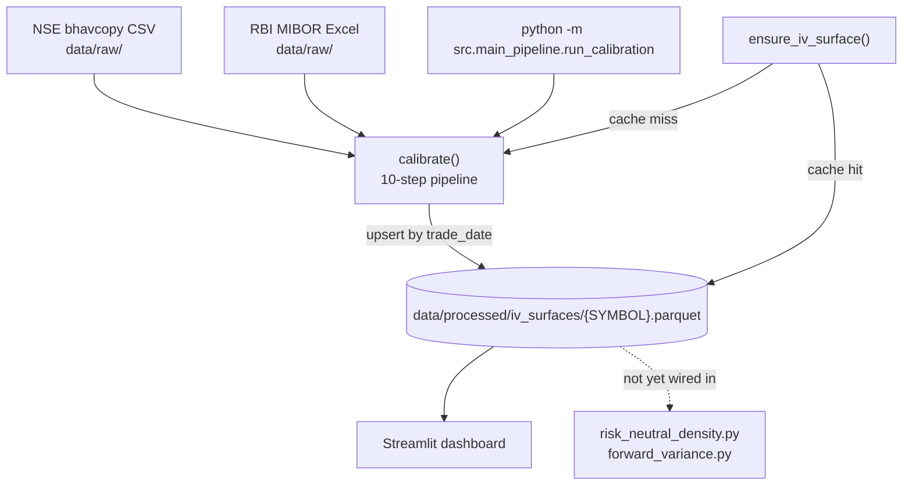
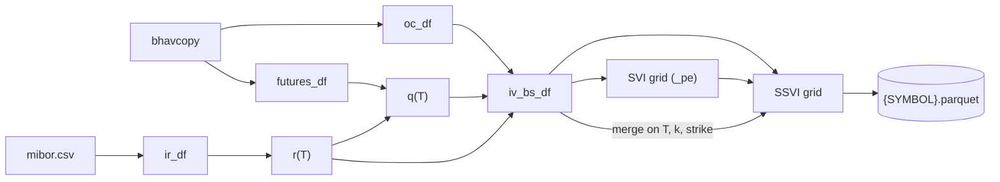

# Project Flow

What runs, in what order, and what each step reads and writes. For *why*, see [design_choices.md](design_choices.md).

## 1. Overview

`run_calibration.py` is the only module that connects data and models. The dashboard only reads the Parquet store.

## 2. Pipeline — `calibrate()` in [run_calibration.py](../src/main_pipeline/run_calibration.py)

Step numbers match the comments in the code.

| # | Step | Code | Produces |
|---|---|---|---|
| 1 | Resolve paths | `_resolve_paths` | Bhavcopy CSV (downloads it if missing); makes sure the date is in `mibor.csv` (from the RBI Excel if needed) |
| 2 | Parse | `BhavcopyParser`, `InterestRateParser` | **`oc_df`**: options with OI ≥ min, joined to the futures close (expiries without futures are dropped), plus `time_to_expiry`, `log_moneyness` = ln(K/F), `pay_off`, `cost_of_carry`. Also **`futures_df`** and **`ir_df`** (3 MIBOR tenors). |
| 3 | Rates and dividends | `NSSCurveFitter`, `DividendFitter` | r(T) from an NSS fit; q = r − cost of carry per futures expiry, interpolated linearly |
| 4 | Black-Scholes IV | `BSFitter.fit` | **`iv_bs_df`**: IV (NaN on failure), PCHIP gap-fills (`iv_interpolated`), `bs_implied_variance`, finite-difference arbitrage diagnostics, and **`iv_valid_for_ssvi`**, the only filter on fit rows |
| 5 | Quality flags | `DataQualityChecker.run` | `vol_regime`, `is_stale`, `pcp_forward_ok`, `slice_liquid`, `is_clean`. Informational only; nothing is filtered out. |
| 6a | SSVI + Dupire | `SSVIConstrainedFitter` | Fits θ per expiry plus global φ, ρ with L-BFGS-B, then builds the (T, k) grid with analytical derivatives and local vol |
| 6b | Per-slice SVI + Dupire | `SVIPerExpiryFitter` | Five-parameter fit per expiry, calendar check, grid; columns are renamed `*_pe` and left-joined onto the SSVI grid |
| 7 | Strikes | — | K = S·e^k·e^{(r−q)T} for every grid point |
| 8 | Market data | merge | Left-joins `iv_bs_df` on (T, k, strike). Pure model rows have `option_type = NaN`. |
| 9 | Validate | `SSVIValidator` | RMSE vs market IV, GJ checks, SSVI − SVI gap and stress flag, written to every row of the date |
| 10 | Save | `ParquetSaver.upsert_impliedvolsurface` | Keeps whitelisted columns and replaces that date's rows in `{SYMBOL}.parquet` |

**Grids:**
- **k:** observed values plus 61 points spanning the data range ±0.5.
- **T:** 20 evenly spaced points plus the traded expiries.

## 3. DataFrame lineage

The stored table is grid-shaped, not one row per contract. Market columns are filled only where a traded contract lands on the grid.

## 4. Dashboard

`app.py` → `render_dashboard()`:
- **Demo mode:** with `DEMO_MODE = True`, it reads the Parquet and you pick a date.
- **Live mode:** the commented-out block calls `ensure_iv_surface()`.

**Data in the session:**
- `df` is the selected date; it drives the metric banner and sections 1–10.
- `full_df` is all dates; it drives section 11, the history charts, which need ≥ 3 dates.

Every chart is a pure function in [plots.py](../frontend/components/plots.py), wrapped in `_safe()`, and each section can be toggled with a checkbox.

## 5. Common failures

| Symptom | Cause | Fix |
|---|---|---|
| `IndexError: index -1 is out of bounds` in step 3 | No MIBOR rate for the date | Add a newer RBI Excel to `data/raw/` |
| `Failed to download FO Bhavcopy (403)` | NSE blocked the request, or it's a holiday | Download the CSV into `data/raw/` manually |
| Very high SSVI RMSE on one date | Front expiry 1 day away | Exclude very short expiries (not yet implemented) |
